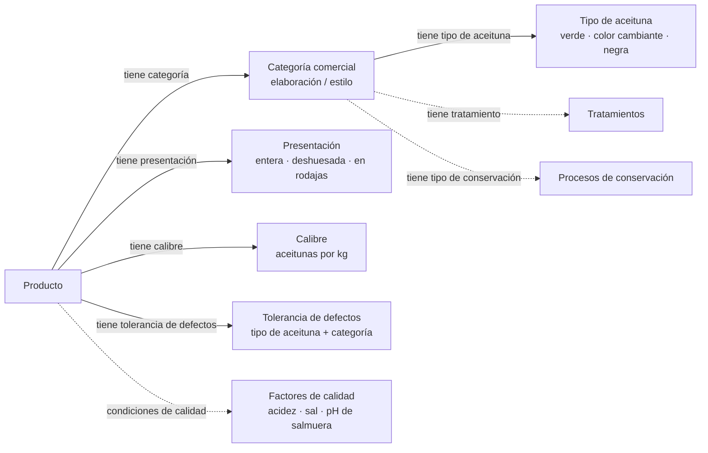

# Ontología de aceitunas de mesa

Guía breve de la ontología de aceitunas de mesa (versión 0.6). Según su cabecera, se creó siguiendo la **Norma del Codex para las Aceitunas de Mesa, CODEX STAN 66-1981**. El modelo abarca tipos de aceituna, elaboraciones comerciales, presentaciones, conservación, calidad del producto y trazabilidad. Los nombres de las entidades se muestran sin enlaces a páginas web.

Documentation in [English](https://github.com/ernestojimenezruiz/table-olives-ontology).

## De un vistazo

- **Tipos de aceituna:** `Tipo_Aceituna` distingue aceitunas verdes (`Aceituna_Verde`), de color cambiante (`Aceituna_Color_Cambiante`) y negras (`Aceituna_Negra`) según el color y la etapa de maduración en que se recogen. Las variedades, como Arbequina, Gordal y Manzanilla, pertenecen a una rama aparte (`Variedades_Aceituna`).
- **Categorías comerciales:** `Categoria_Producto` incluye aceitunas comerciales verdes, de color cambiante y negras, con subclases para elaboraciones naturales, aderezadas con lejía alcalina, partidas, seccionadas, conservadas en sal seca o ennegrecidas. Aquí *natural* designa una elaboración, no solo el color del fruto.
- **Presentación:** `Presentacion_Aceituna` recoge formas como aceitunas enteras, deshuesadas, rellenas, en mitades, en cuartos o en rodajas. Por ejemplo, `Aceituna_Entera` tiene hueso, mientras que `Aceituna_Deshuesada` lo excluye.
- **Procesado y conservación:** `Tratamiento` incluye tratamientos con lejía alcalina o salmuera, oxidación y cortes; `Procesos_Conservacion` incluye conservación en salmuera, fermentación, sal seca, refrigeración y conservación por calor.
- **Calidad y productos:** `Producto` se relaciona con una categoría comercial, una presentación, un calibre (`Calibrado`) y una tolerancia de defectos (`Tolerancia_Defectos`). Otras clases representan la acidez, la salinidad y el pH de la salmuera, así como límites de defectos por tipo de aceituna y categoría de calidad.
- **Cadena de suministro:** los actores (`Actor`), las operaciones (`Operacion`) y las unidades trazables (`UnidadTrazable`) incluyen productores, envasadores, distribuidores, lotes y unidades comerciales o logísticas.

## Mapa conceptual

*Las etiquetas de las relaciones son expresiones en español de las propiedades `tieneTipoAceituna`, `tieneCategoria`, `tienePresentacion`, `tieneCalibre`, `tieneToleranciaDefectos`, `tieneTratamiento` y `tieneTipoConservacion`. Las flechas siguen el sentido de las propiedades (por ejemplo, `Producto tieneCategoria Categoria_Producto`). Las líneas discontinuas resumen el modelado de categorías y calidad; no implican que todas esas clases tengan una restricción de dominio declarada.*

## Cómo funciona el modelo

La ontología utiliza restricciones de clases OWL para definir algunos tipos y categorías. Por ejemplo, la clase de calibre `Calibre_101_110` limita el número de aceitunas por kilogramo a **101–110**; `pH_Salmuera_4.3` establece un **pH máximo de 4,3**, y `Salinidad_Salmuera_5` establece una **concentración mínima de cloruro de sodio del 5 %**. Las clases de tolerancia de defectos distinguen las categorías **Extra**, **Primera** y **Estándar**, con límites específicos para aceitunas verdes, de color cambiante y negras. Estos son los *umbrales codificados en la ontología*; no se presentan como valores de la edición vigente de la norma Codex.

> **Nota de lectura:** Las etiquetas de las clases describen conceptos; los axiomas OWL expresan condiciones formales. Un dato ausente en el registro de un producto no equivale a un cero medido: OWL suele utilizar razonamiento de mundo abierto. La ontología también contiene la clase de ejemplo `Defectos_example`, descrita como insatisfacible al razonar sobre ella porque su total de defectos supera el límite de la categoría Estándar.

## Referencia al Codex

- [Codex Alimentarius: buscador oficial de textos](https://codex.fao.org/codex-texts/find-a-codex-text) — busque **CXS 66-1981** o **Norma para las Aceitunas de Mesa** y seleccione el idioma del documento en la ficha de la norma. Se ha retirado el enlace directo al PDF anterior porque ya no funciona.

La declaración de procedencia de la ontología remite a la norma Codex, pero sus axiomas son una formalización concreta y no sustituyen el texto íntegro ni necesariamente vigente de la norma. Para usos regulatorios, consulte la versión más reciente del Codex.
