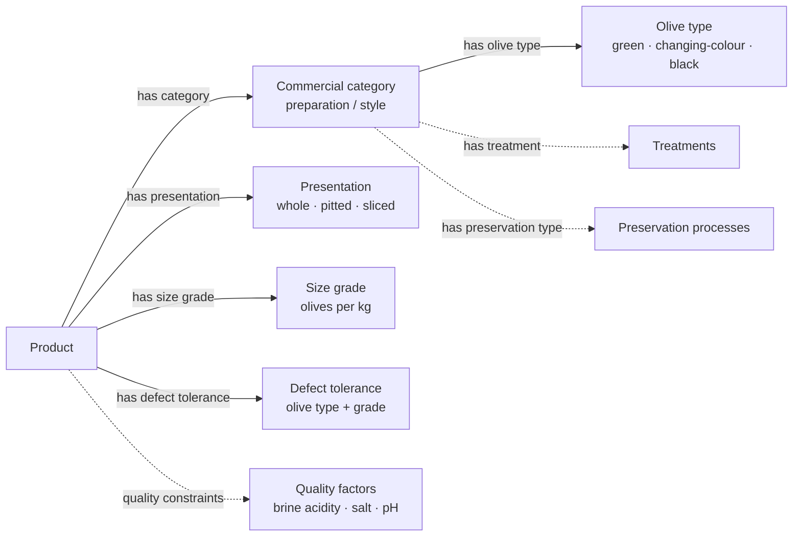

# Table Olives Ontology / Ontología de aceitunas de mesa

Ontología creada siguiendo la Norma del CODEX para las Aceitunas de Mesa (CODEX STAN 66-1981). La ontología contiene anotaciones en español e inglés. Documentación en [español](README-es.md).

A compact guide to the Spanish table-olives ontology (version 0.6). It was created following the **Codex Standard for Table Olives, CODEX STAN 66-1981**. The model covers olive types, commercial preparations, presentation, preservation, product quality and traceability. Spanish names are shown below alongside English explanations; the linked names refer to the ontology's original entity IRIs.

Ontology: [ttl version ](table-olives-ontology-es-en_v0.6.ttl)

## At a glance

- **Olive type:** `Tipo_Aceituna` distinguishes green (`Aceituna_Verde`), changing-colour (`Aceituna_Color_Cambiante`) and black (`Aceituna_Negra`) olives by colour and harvest/maturation stage. Named cultivars, such as Arbequina, Gordal and Manzanilla, sit in a separate varieties branch (`Variedades_Aceituna`).
- **Commercial category:** `Categoria_Producto` includes green, changing-colour and black commercial olives, with subclasses for preparations such as natural, lye-treated, split, scored, dry-salted and darkened olives. Here *natural* describes a preparation, not simply the fruit's colour.
- **Presentation:** `Presentacion_Aceituna` records forms such as whole, pitted, stuffed, halved, quartered and sliced olives. For example, `Aceituna_Entera` has a stone, whereas `Aceituna_Deshuesada` excludes it.
- **Processing and preservation:** `Tratamiento` includes alkaline-lye, brine, oxidation and cutting treatments; `Procesos_Conservacion` includes brining, fermentation, dry salt, refrigeration and heat preservation.
- **Quality and products:** `Producto` is connected to a commercial category, presentation, size grade (`Calibrado`) and defect tolerance (`Tolerancia_Defectos`). Further classes represent brine acidity, salinity and pH, and defect limits for olive types and quality grades.
- **Supply chain:** actors (`Actor`), operations (`Operacion`) and traceable units (`UnidadTrazable`) include producers, packers, distributors, batches and commercial or logistic units.

## Concept map

*Property names in the diagram are English glosses of the ontology's Spanish property IRIs. Arrows follow the actual property direction (for example, `Producto tieneCategoria Categoria_Producto`). Dashed arrows summarise category and quality modelling rather than asserting a domain restriction on every class.*

## How the model works

The ontology uses OWL class restrictions to define some types and grades. For example, a size-grade class such as `Calibre_101_110` constrains the number of olives per kilogram to **101–110**; `pH_Salmuera_4.3` sets a **maximum pH of 4.3**, and `Salinidad_Salmuera_5` sets a **minimum sodium chloride concentration of 5%**. Defect-tolerance classes distinguish **Extra**, **First** (`Primera`) and **Standard** (`Estándar`) categories, with separate thresholds for green, changing-colour and black olives. These are descriptions of the *ontology's encoded thresholds*, not a claim about the current Codex edition.

> **Reading note:** Class labels describe concepts, while OWL axioms express formal conditions. Do not treat an absent value in an individual product record as a measured zero; OWL normally uses open-world reasoning. Also, this ontology contains an example class, `Defectos_example`, intentionally described as unsatisfiable when reasoned over because its defect total exceeds the Standard limit.

## Codex reference

- [Codex Alimentarius: official text catalogue](https://codex.fao.org/codex-texts/find-a-codex-text) — search for **CXS 66-1981** or **Standard for Table Olives**, then choose a document language from the standard's record. The old direct PDF link has been removed because it no longer works.

The ontology's provenance statement points to the Codex standard, but its class axioms are a particular formalisation and should not be mistaken for the full or necessarily current standard. Consult the latest Codex text for regulatory use.
